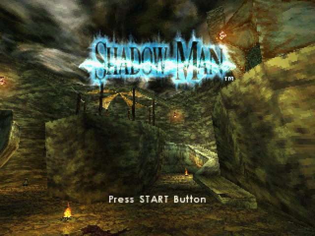
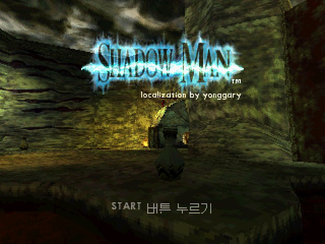
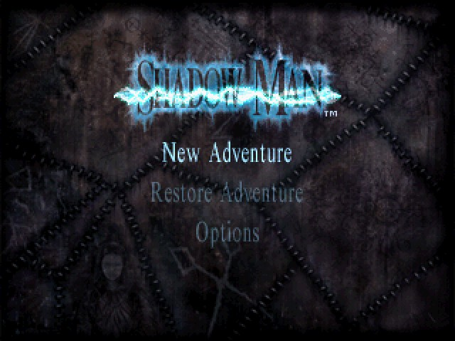
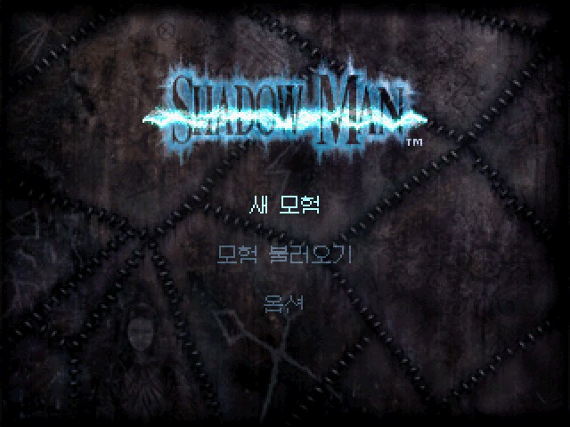
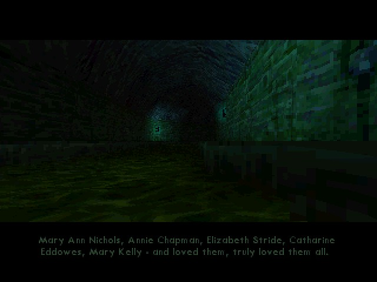
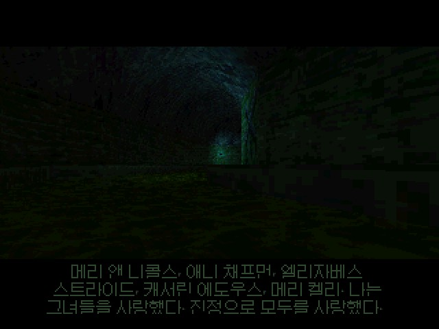
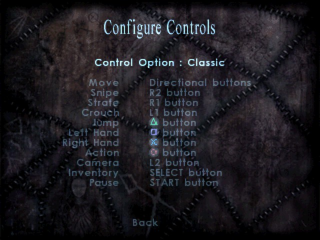
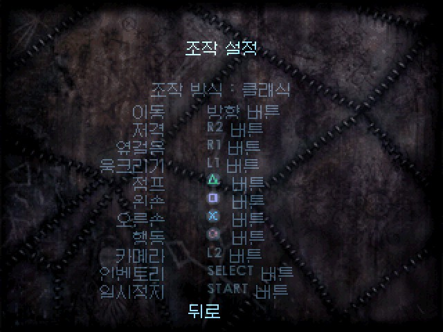
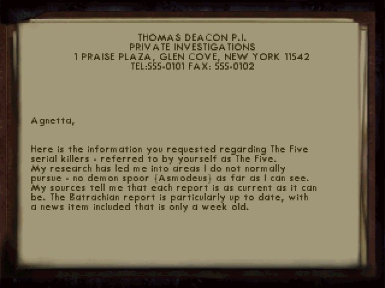
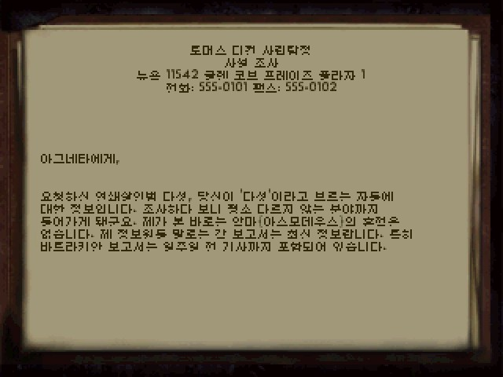

# 섀도우맨 한글패치 (PS1 북미판)

**Shadow Man** PS1 북미판 **SLUS-00895** 한글패치입니다.

> 본 한글패치는 개인이 제작한 비공식·비상업적 팬 한글패치입니다. — by **Yonggary6425 (용가리)**
> 게임 이미지(bin/cue)는 포함되어 있지 않습니다. 직접 소유한 원본으로만 사용해 주세요.

| 원본 북미판 | 한글패치 |
|---|---|
|  |  |
|  |  |
|  |  |
|  |  |
|  |  |

(DuckStation 세이브 스테이트의 화면 버퍼를 그대로 저장한 320×240 화면을 2배로 키운 것입니다.)

---

## 한글화 범위

- **대사 자막**: 74개 장면 985줄 전부. 자막이 뜨는 시점과 순서는 원본 그대로입니다.
- **메뉴·시스템 문구**: 메인 메뉴, 옵션, 조작 설정, 게임 중 메뉴, 메모리 카드 안내, 지역명, 아이템명 (170줄)
- **문서**: 네티의 파일(경찰 보고서), 잭의 일기, 세인트 제임스의 편지·예언·유물 목록 (82개 문단)
- **그 밖의 문구**: 실행 파일 안의 장면 제목 등 42개, 크레딧 직책 53개
- **한글 출력 기능**을 새로 넣었습니다. 원본 PS1 게임에는 한글 글꼴이 없습니다.
  - 메뉴·자막용 12px 글꼴 798자, 문서용 8px 글꼴 590자 (Galmuri, SIL OFL 1.1)
- 한글에 맞춰 화면 배치를 고쳤습니다.
  - 자막: 줄바꿈 기준 64→46바이트, 줄 간격 10→13px, 자막 위치를 조금 아래로
  - 게임 옵션·게임 중 메뉴 줄 간격 12→14px, 조작 설정 화면 줄 간격 10→13px
- 타이틀 화면 `localization by yonggary` 표기, 크레딧 끝 한글패치 문구

음성은 영어 그대로입니다. 그래픽으로 그린 글자(로딩 화면의 Loading 등)는 바꾸지 않았습니다.

자세한 원본 비교는 [`docs/`](docs/) 의 PDF를 참고하세요.

---

## 준비물

- PS1 북미판 원본 **Shadow Man (USA)** / **SLUS-00895** (bin/cue, 2트랙)
  - `Shadow Man (USA) (Track 1).bin` — 크기 534,042,768 바이트, MD5 `763cd348b7f8da79963f97d05c19fb65`
  - `Shadow Man (USA) (Track 2).bin` — 오디오 트랙, 바꾸지 않습니다
  - Track 1 의 크기와 MD5가 같은 원본에만 적용됩니다.
- Windows 10/11 (추가 설치 없음) 또는 Python 3.8 이상
- 빈 디스크 공간 약 550 MB

## 적용 방법

[Releases](../../releases) 에서 최신 `ShadowMan_KOR_Patch_v*.zip` 을 받아 압축을 풉니다.

### A. Windows

1. **`Shadow Man (USA) (Track 1).bin`** 파일을 **`패치하기.bat`** 위에 끌어다 놓습니다.
2. 같은 폴더에 **`Shadow Man (USA) (Track 1) (Korean).bin`** 이 새로 생깁니다. (원본은 그대로 둡니다)
3. 같은 폴더에 원본 cue 가 있으면 **`Shadow Man (USA) (Korean).cue`** 도 만들어 줍니다. 에뮬레이터에서 이 cue 를 여세요.
4. `완료!` 가 나오면 성공입니다.

### B. Python (macOS / Linux)

```
python3 patch.py "Shadow Man (USA) (Track 1).bin"
```

> 패처는 원본 bin 에서 바뀌지 않은 부분을 읽어 오고, 달라진 섹터만 패치 데이터에서 채워 새 bin 을 만듭니다.
> 적용 전에 원본의 MD5를, 적용 후에 결과의 MD5(`2329bb09e9125d3c9af5738199aca266`)를 검사합니다.
> 새 cue 는 원본 cue 에서 Track 1 파일 이름만 바꾼 것이라 Track 2 는 원본 파일을 그대로 씁니다.

## 주의

- **세이브 스테이트로 불러오면 이전 글꼴·문장이 보일 수 있습니다.** 한글 글꼴이 메모리에 들어 있기 때문입니다. 메모리 카드 세이브로 불러오거나 새로 시작해 주세요.
- 이전 패치본에 다시 적용하지 말고, 항상 **원본 bin** 에 적용해 주세요.
- 테스트 환경: DuckStation 0.1-12640 (실기에서는 확인하지 않았습니다)

## 알려진 사항

- 실제 화면으로 확인한 범위는 타이틀, 메인 메뉴, 게임 옵션, 조작 설정, 인트로 내레이션 자막, 바이유 첫 장면, 게임 중 메뉴, 모험 저장 화면, 인벤토리, 네티의 파일 1~2쪽입니다.
- 이후 레벨의 자막, 잭의 일기·세인트 제임스 문서, 크레딧 화면, 저장 파일 목록의 장면 제목은 게임 안에서 확인하지 못했습니다.
- 4줄 이상으로 나뉘는 자막은 확인하지 못했습니다.
- 한글 글꼴에 없는 글자는 표시되지 않습니다.

## 구성 파일

```
patcher/
  patch.ps1      적용기 본체 (Windows PowerShell 기본 기능)
  patch.py       Python 적용기
  sm_kor.bin     한글패치 데이터
  README.txt     사용법
  (패치하기.bat  드래그 앤 드롭 실행 파일 - Releases 의 zip 에만 들어 있습니다)
docs/
  원본 비교 PDF, screenshots/
```

## 크레딧

- 한글화·패처 제작: **Yonggary6425 (용가리)**
- 번역·한글 출력 도구 제작 보조: Claude (Anthropic)
- 한글 글꼴: Galmuri11, Galmuri7 (© Lee Minseo, SIL Open Font License 1.1, `licenses/`)
- 원작: Shadow Man © 1999 Acclaim Entertainment. 모든 권리는 원저작권자에게 있습니다.

## 버그 제보

오역·오탈자·표시 문제는 [Issues](../../issues) 에 장면(레벨·상황)과 스크린샷을 함께 올려 주세요.
